# 2단계 보고서: 개인 VM에 직접 설치해서 배포하기

- 대상 VM: `ktc-s07` (Ubuntu 24.04.5 LTS)
- 작업일: 2026-11-02
- 앱: 할 일 노트 3티어 (web: Nginx / api: FastAPI / db: PostgreSQL)

## 1. 결과 요약

| 확인 항목 | 결과 | 증거 |
|---|---|---|
| `curl localhost/api/todos` 응답 | ✅ JSON 목록 응답 (추가·조회 동작) | [08](img/08-api-todos.png) |
| 브라우저 화면 (`localhost`, PORTS 80) | ✅ 화면 표시, DB의 할 일 2개 보임 | [09](img/09-browser.png) |
| `sudo reboot` 후 자동 복구 | ✅ 세 서비스 자동 시작, 데이터 유지 | [10](img/10-after-reboot.png), [11](img/11-browser-after-reboot.png) |

## 2. 구성

컨테이너 없이 세 티어를 VM 위에서 직접 실행합니다. API는 루프백에만 열려 있고, 외부에서는 Nginx(80)를 거쳐서만 접근할 수 있습니다.

```
브라우저 ──(VS Code PORTS: 80)──▶ Nginx :80 ──/api/*──▶ uvicorn 127.0.0.1:8000 ──▶ PostgreSQL 127.0.0.1:5432
                                   │                   (systemd: todo-api)          (systemd: postgresql)
                                   └─ / → /var/www/todo-note (정적 화면)
```

| 티어 | 설치 방법 | 실행 방법 | 위치 |
|---|---|---|---|
| 데이터 | `apt install postgresql` (16.15) | systemd `postgresql` (패키지 기본, enabled) | 127.0.0.1:5432, DB·사용자 `todo` |
| 애플리케이션 | `apt install python3-venv` (3.12.3) + venv에 `requirements.txt` | systemd `todo-api` (직접 작성, enabled) | `/opt/todo-note/api`, 127.0.0.1:8000 |
| 프레젠테이션 | `apt install nginx` (1.24.0) | systemd `nginx` (패키지 기본, enabled) | `/var/www/todo-note`, :80 |

이 앱은 Node.js가 아니라 Python(FastAPI)이라서, 런타임으로 Python과 venv를 설치했습니다.

## 3. 진행 과정

### 3.1 저장소 clone
`~/todo-note`에 clone한 상태를 확인했습니다.

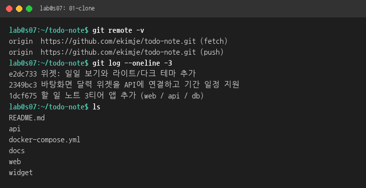

### 3.2 80번 포트 비우기
이 VM에서는 앞 과목의 kind 클러스터(`lab-control-plane`)가 80·8080번을 쓰고 있었습니다. 과제 확인 명령(`curl localhost/...`)은 Nginx가 80번에 있어야 하므로 kind 컨테이너 3개를 멈췄습니다. 또 재부팅 뒤 kind가 다시 80번을 차지하지 않도록 자동 재시작을 껐습니다(`docker update --restart=no`). 데이터는 남아 있어 `docker start`로 되살릴 수 있습니다.

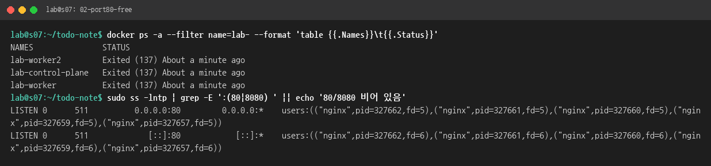

### 3.3 apt로 DB·Nginx·런타임 설치
```bash
sudo apt-get update
sudo apt-get install -y postgresql nginx python3-venv
```
PostgreSQL과 Nginx는 패키지가 systemd 서비스를 등록하고 `enabled`로 켜 둡니다.

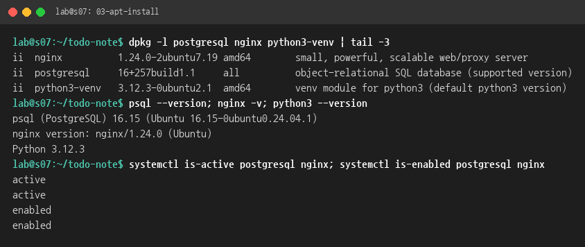

### 3.4 DB와 사용자 만들기
```bash
PW=$(openssl rand -hex 24)
sudo -u postgres psql -v pw="$PW" -c "CREATE ROLE todo LOGIN PASSWORD :'pw';" -c "CREATE DATABASE todo OWNER todo;"
```
접속 정보는 `/etc/todo-note/api.env`(root만 읽기, `600`)에만 두고 저장소에는 넣지 않았습니다. PostgreSQL은 기본 설정대로 루프백(127.0.0.1)에서만 받습니다. 테이블(`todos`)은 API가 시작할 때 자동으로 만듭니다.

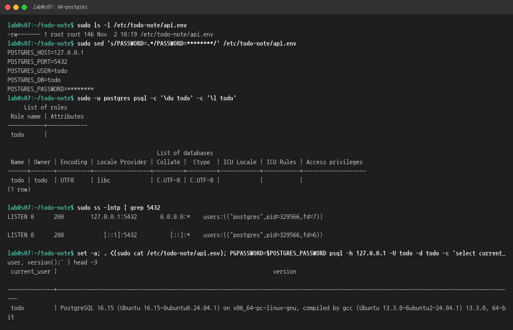

### 3.5 API 설치
```bash
sudo useradd --system --no-create-home --shell /usr/sbin/nologin todo-api
sudo install -d /opt/todo-note/api /var/www/todo-note
sudo cp -r api/app api/requirements.txt /opt/todo-note/api/
sudo python3 -m venv /opt/todo-note/venv
sudo /opt/todo-note/venv/bin/pip install -r /opt/todo-note/api/requirements.txt
```
API는 로그인할 수 없는 전용 시스템 사용자(`todo-api`)로 실행합니다. 코드는 root 소유라서 실행 사용자가 코드를 고칠 수 없습니다.

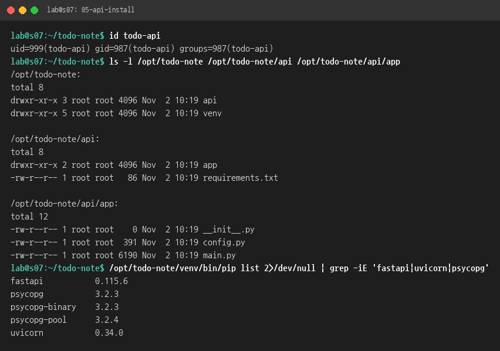

### 3.6 API를 systemd 서비스로 등록
서비스 파일: [deploy/todo-api.service](../../deploy/todo-api.service)

```bash
sudo cp deploy/todo-api.service /etc/systemd/system/
sudo systemctl daemon-reload
sudo systemctl enable --now todo-api
```
- `enable`: 재부팅 때 자동 시작합니다(`multi-user.target`에 연결).
- `Requires`/`After=postgresql.service`: DB가 먼저 뜬 뒤에 시작합니다.
- `Restart=on-failure`: 죽으면 3초 뒤 다시 띄웁니다.
- `--host 127.0.0.1`: Nginx만 접근하므로 외부에는 열지 않습니다.
- `ProtectSystem=strict`, `ProtectHome`, `NoNewPrivileges`: 서비스가 파일 시스템을 쓰거나 권한을 올리지 못하게 막습니다.

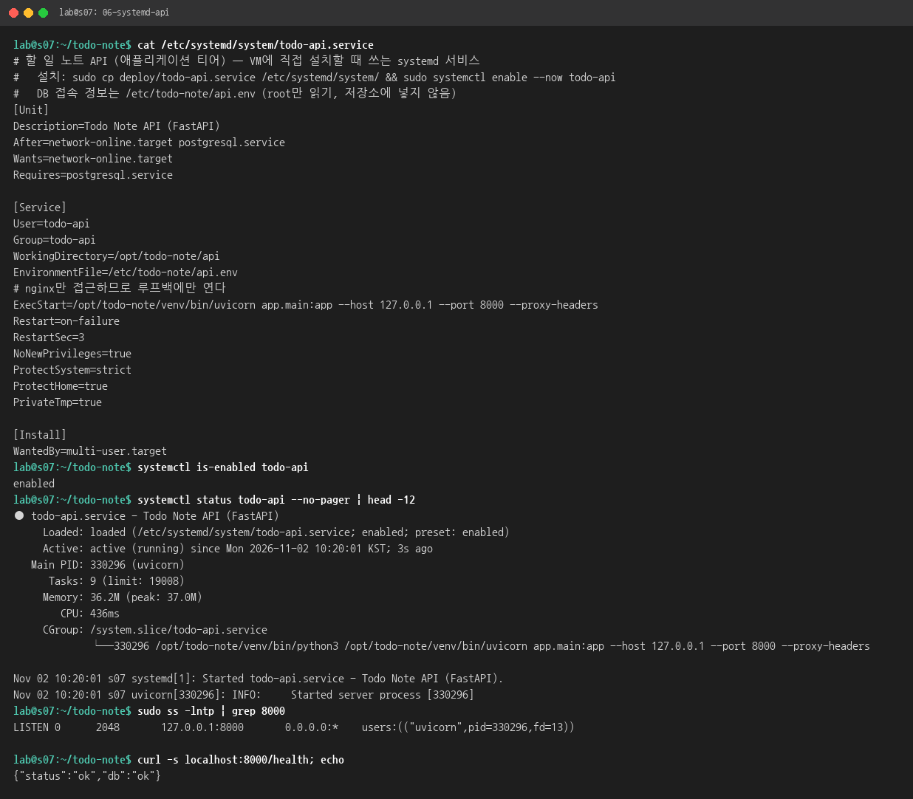

### 3.7 Nginx: 웹 화면 제공 + /api 전달
설정 파일: [deploy/nginx-todo-note.conf](../../deploy/nginx-todo-note.conf). 컨테이너용 [web/nginx.conf](../../web/nginx.conf)와 같고, 두 가지만 바꿨습니다.

| | 컨테이너(compose) | VM 직접 설치 |
|---|---|---|
| 정적 파일 | `/usr/share/nginx/html` | `/var/www/todo-note` |
| API 전달 | `proxy_pass http://api:8000/;` | `proxy_pass http://127.0.0.1:8000/;` |

```bash
sudo cp -r web/public/. /var/www/todo-note/
sudo cp deploy/nginx-todo-note.conf /etc/nginx/sites-available/todo-note
sudo ln -s /etc/nginx/sites-available/todo-note /etc/nginx/sites-enabled/
sudo rm /etc/nginx/sites-enabled/default
sudo nginx -t && sudo systemctl reload nginx
```
`proxy_pass` 끝의 `/` 때문에 `/api/todos`가 `/todos`로 바뀌어 API에 전달됩니다. API는 `root_path="/api"`로 설정되어 있어서 Swagger 문서(`/api/docs`) 경로도 맞습니다.

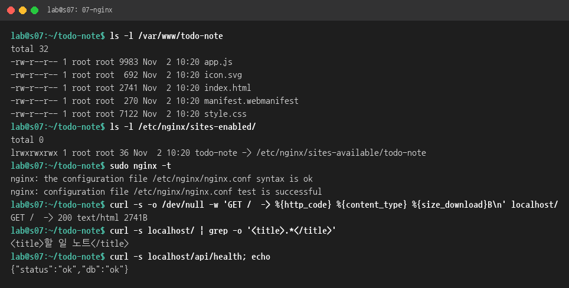

### 3.8 확인: curl localhost/api/todos
처음에는 빈 목록 `[]`이 나옵니다. 할 일 2개를 추가한 뒤 다시 조회하면 API와 DB 양쪽에서 같은 데이터가 보입니다.

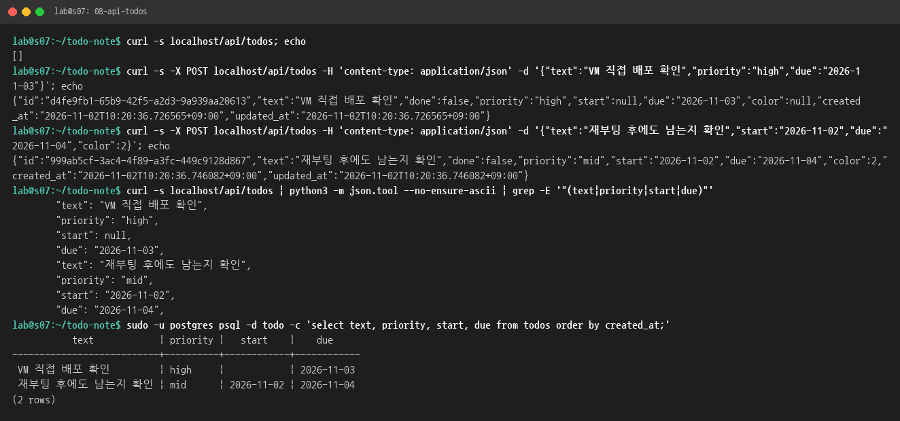

### 3.9 확인: 브라우저
VS Code Remote-SSH의 PORTS 탭에서 80번을 전달해 `http://localhost`로 엽니다. 아래 이미지는 같은 주소를 VM 안의 헤드리스 Chromium으로 캡처한 것입니다. 오른쪽 위에 "서버에 저장됨"이 표시되고, 앞에서 추가한 할 일 2개가 보입니다.


### 3.10 재부팅 후 확인
재부팅 전 상태: 세 서비스 모두 `enabled`이고, kind 컨테이너는 `restart=no`입니다.

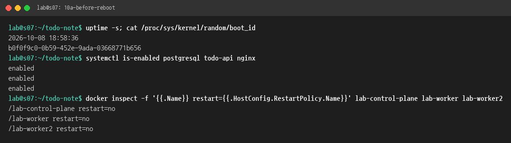

`sudo reboot` 뒤 다시 접속해 [tools/after-reboot.sh](tools/after-reboot.sh)로 확인했습니다.

- `boot_id`가 `b0f0f9c0…`에서 `c69a8886…`로 바뀌었습니다(부팅 시각 10:24:02). 실제로 재부팅된 것입니다.
- `postgresql`, `todo-api`, `nginx` 세 서비스가 모두 `active`입니다. 손으로 띄우지 않았는데 `todo-api`가 부팅 11초 뒤(10:24:13) 자동으로 시작했습니다.
- `/api/health`는 `ok`이고, 재부팅 전에 넣은 할 일 2개가 그대로 조회됩니다(DB 데이터 유지).

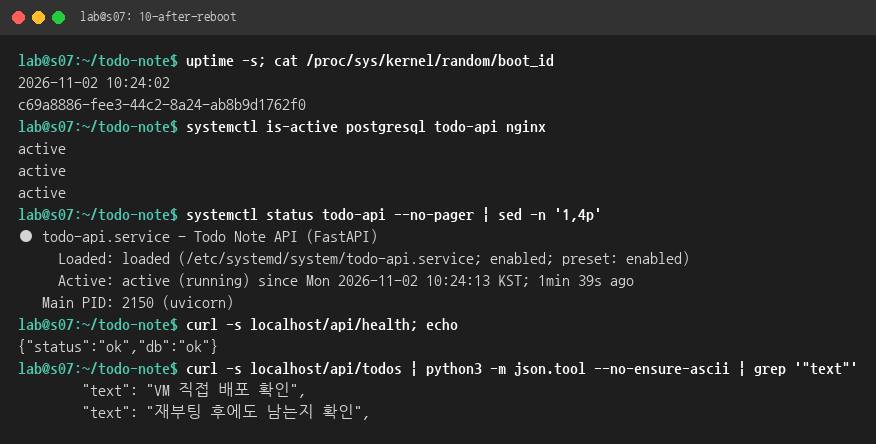

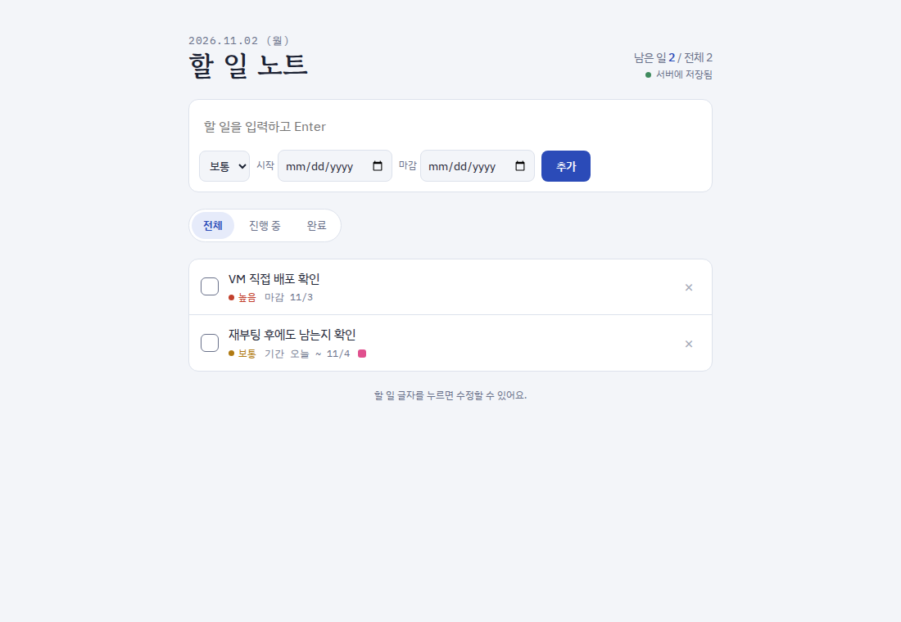

## 4. 문제와 해결

| 문제 | 원인 | 해결 |
|---|---|---|
| Nginx를 띄울 80번 포트가 이미 사용 중 | kind 클러스터 컨테이너가 0.0.0.0:80, 8080을 점유 | kind 컨테이너를 멈추고 자동 재시작을 끔 |
| 설정 직후 `/`가 Nginx 기본 페이지(615B), `/api/health`가 404 | `systemctl reload` 직후 바로 curl해서 옛 설정(기본 사이트)이 응답함 | 잠시 뒤 다시 확인하니 정상(`/` 2741B, `/api/health` ok). 설정 오류는 아님 |

## 5. 컨테이너 배포(1단계)와 비교

| | Docker Compose | VM 직접 설치 |
|---|---|---|
| 설치 | 이미지 빌드(`docker compose up --build`) | `apt` + `pip` |
| 실행·재시작 | `restart: unless-stopped` | systemd `enable` + `Restart=on-failure` |
| 티어 분리 | 네트워크 2개(`backend`는 internal) | DB·API를 루프백에만 열어 Nginx만 외부 노출 |
| 비밀 정보 | `.env` | `/etc/todo-note/api.env` (root 600) |
| 데이터 | 볼륨 `db-data` | `/var/lib/postgresql/16/main` |
| Python | 3.13 (이미지) | 3.12.3 (Ubuntu 기본, 같은 requirements로 동작) |

## 부록: 파일

- `deploy/todo-api.service`, `deploy/nginx-todo-note.conf`: 이번 단계에서 추가한 배포 파일
- `docs/step2-vm-deploy/logs/*.txt`: 각 캡처의 원문 출력
- `docs/step2-vm-deploy/tools/`: 캡처 도구(터미널 출력 → PNG, 헤드리스 브라우저 캡처)와 재부팅 뒤 확인 스크립트
