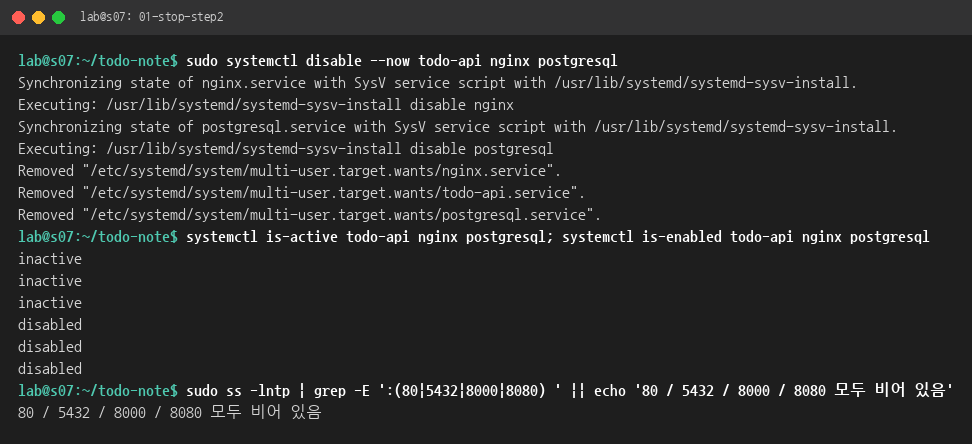
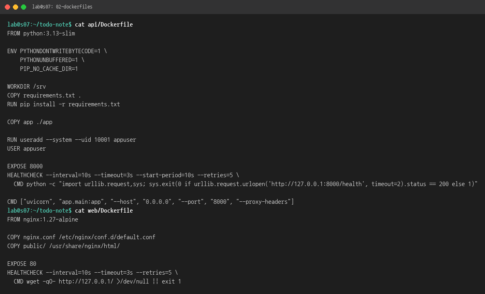
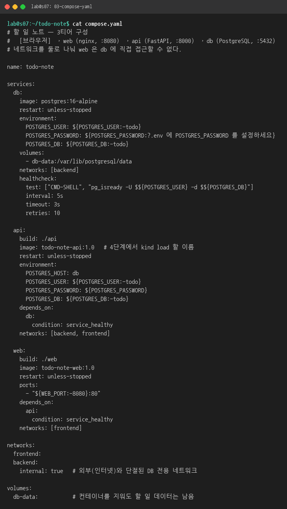
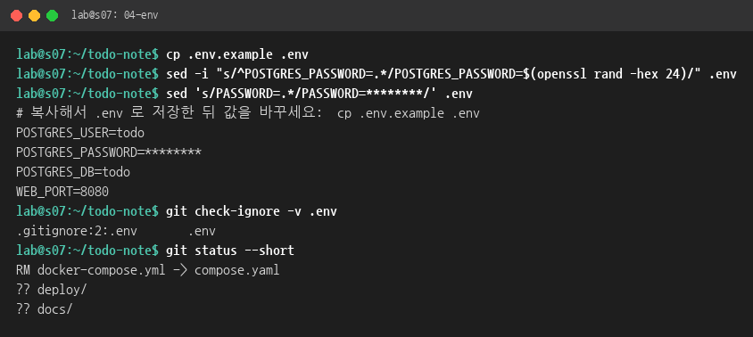
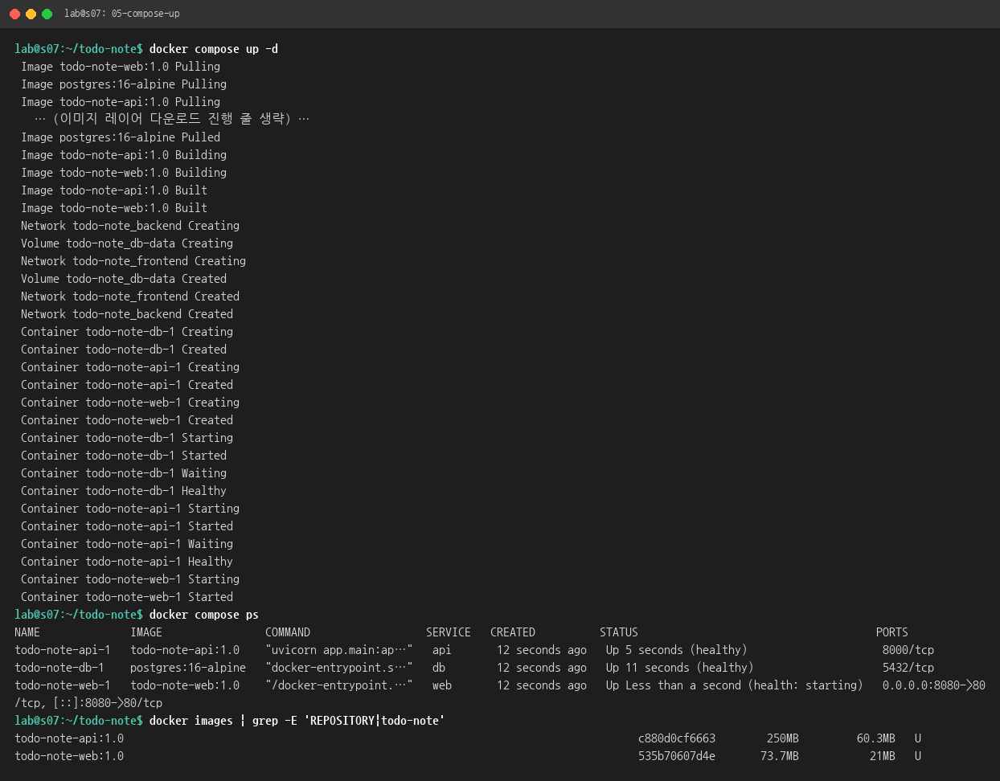
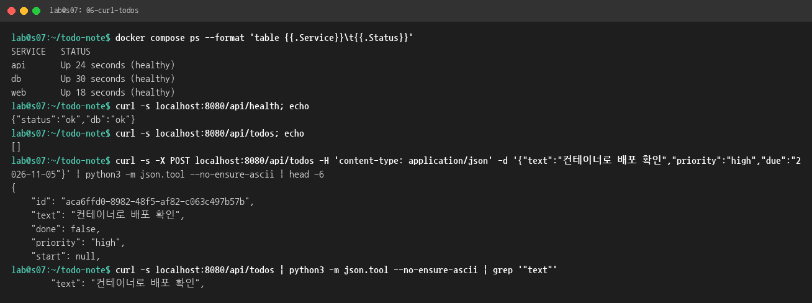
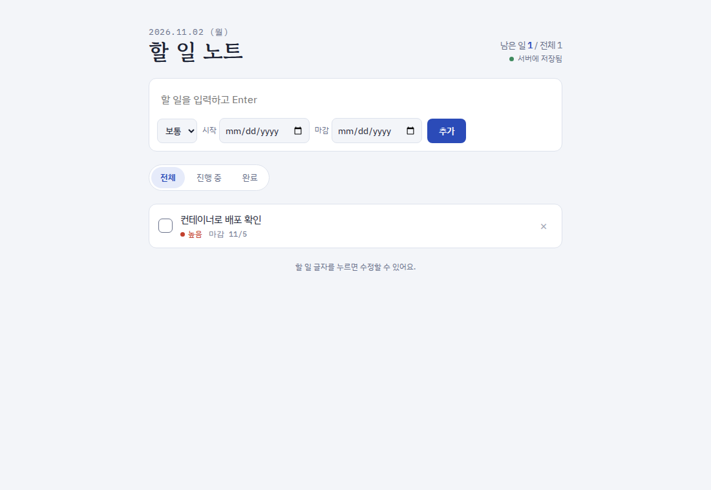
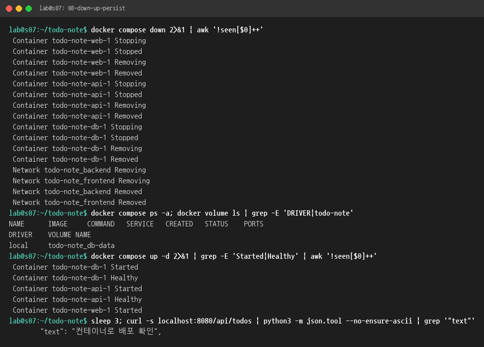

# 3단계 보고서: Docker Compose로 컨테이너화하기

- 대상 VM: `ktc-s07` (Ubuntu 24.04.5, Docker Compose v5.5.1)
- 작업일: 2026-11-02
- 앞 단계: [2단계 VM 직접 설치](../step2-vm-deploy/REPORT.md) · 다음 단계: [4단계 Kubernetes](../step4-k8s/REPORT.md)

## 1. 결과 요약

| 확인 항목 | 결과 | 캡처 |
|---|---|---|
| `docker compose up -d` 한 줄로 전체 실행 | ✅ db → api → web 순서로 떠서 셋 다 `healthy` | [05](img/05-compose-up.png) |
| 앱 동작 (curl·브라우저) | ✅ `localhost:8080/api/todos` 응답, 화면에 할 일 표시 | [06](img/06-curl-todos.png), [07](img/07-browser.png) |
| `down` 후 다시 `up` 해도 데이터 유지 | ✅ 볼륨 `todo-note_db-data`가 남아 할 일이 그대로 보임 | [08](img/08-down-up-persist.png) |
| `.env`는 Git에 올리지 않음 | ✅ `.gitignore` 2번째 줄이 `.env`를 무시 | [04](img/04-env.png) |

## 2. 구성 한눈에 보기

```
브라우저 ──▶ localhost:8080 ──▶ [web 컨테이너: nginx :80] ──/api/*──▶ [api 컨테이너: uvicorn :8000] ──▶ [db 컨테이너: postgres :5432]
                                  frontend 네트워크 ──────────────────────┘  └────────── backend 네트워크(internal) ──┘
                                                                                                   │
                                                                                         볼륨 todo-note_db-data
```

| 서비스 | 이미지 | 만드는 방법 | 외부 포트 |
|---|---|---|---|
| web | `todo-note-web:1.0` | [web/Dockerfile](../../web/Dockerfile) (nginx:1.27-alpine + 정적 파일 + nginx.conf) | 8080 → 80 |
| api | `todo-note-api:1.0` | [api/Dockerfile](../../api/Dockerfile) (python:3.13-slim + requirements + app) | 없음 |
| db | `postgres:16-alpine` | 공식 이미지 그대로 | 없음 |

> **용어**
> - **이미지**: 실행에 필요한 파일을 묶어 둔 꾸러미입니다. **컨테이너**는 그 이미지를 실행한 것입니다.
> - **볼륨**: 컨테이너를 지워도 남는 저장 공간입니다. DB 데이터를 여기에 둡니다.
> - **compose.yaml**: 여러 컨테이너를 어떻게 띄울지 적어 두는 설계도입니다.

## 3. 따라 하기

모든 명령은 저장소 폴더(`~/todo-note`)에서 실행합니다.

### 3.1 2단계 서비스 멈추기 (포트 충돌 방지)
2단계에서 VM에 직접 띄운 Nginx(80), PostgreSQL(5432), API(8000)가 켜져 있으면 포트가 겹칩니다. 패키지는 지우지 않고 **멈춘 뒤 자동 시작만 끕니다**.
```bash
sudo systemctl disable --now todo-api nginx postgresql
sudo ss -lntp | grep -E ':(80|5432|8000|8080) ' || echo '모두 비어 있음'
```
- `disable --now`: 지금 멈추고(`stop`), 재부팅해도 켜지지 않게 합니다(`disable`).
- 마지막 줄에 **"모두 비어 있음"**이 나오면 성공입니다.



### 3.2 Dockerfile 확인 (web, api 각각)
저장소에 이미 두 Dockerfile이 있어서 그대로 씁니다.



| Dockerfile 줄 | 뜻 |
|---|---|
| `FROM python:3.13-slim` | 파이썬이 설치된 가벼운 리눅스에서 시작 |
| `COPY requirements.txt .` → `RUN pip install` → `COPY app` | 라이브러리를 먼저 설치하고 코드는 나중에 복사합니다. 코드만 바뀌면 설치 단계는 캐시를 재사용해 빌드가 빨라집니다 |
| `USER appuser` | root가 아닌 일반 사용자로 실행(보안) |
| `HEALTHCHECK` | `/health`가 200이면 `healthy`. compose가 이 값을 보고 다음 서비스를 띄웁니다 |
| `FROM nginx:1.27-alpine` + `COPY nginx.conf`, `COPY public/` | Nginx 이미지에 설정과 화면 파일만 얹습니다 |

### 3.3 compose.yaml 작성
과제가 정한 파일 이름에 맞게 `docker-compose.yml`을 **`compose.yaml`로 바꿨습니다**(`git mv`). 또 4단계에서 kind에 넣을 수 있도록 이미지 이름을 고정했습니다.
```yaml
  api:
    build: ./api
    image: todo-note-api:1.0   # 4단계에서 kind load 할 이름
  web:
    build: ./web
    image: todo-note-web:1.0
```



핵심 부분은 다음과 같습니다.
- `volumes: - db-data:/var/lib/postgresql/data`: DB 파일을 이름 있는 볼륨에 저장합니다. 그래서 `down`해도 남습니다.
- `POSTGRES_PASSWORD: ${POSTGRES_PASSWORD:?...}`: 값은 `.env`에서 읽습니다. 없으면 실행하지 않고 에러를 냅니다.
- `depends_on: condition: service_healthy`: db가 healthy가 된 뒤 api를, api가 healthy가 된 뒤 web을 띄웁니다.
- `backend` 네트워크(`internal: true`): db는 api하고만 통신하고, web과 인터넷에서는 닿지 않습니다.
- `ports: "8080:80"`: 밖으로 여는 포트는 web의 8080 하나뿐입니다.

### 3.4 .env 만들기 (비밀번호, Git 제외)
```bash
cp .env.example .env
sed -i "s/^POSTGRES_PASSWORD=.*/POSTGRES_PASSWORD=$(openssl rand -hex 24)/" .env
git check-ignore -v .env     # .gitignore:2:.env  .env  → 무시됨
git status --short           # 목록에 .env 가 없어야 정상
```
- `openssl rand -hex 24`: 48자리 무작위 비밀번호를 만듭니다. 직접 정한 비밀번호를 넣어도 됩니다.
- 캡처에서는 비밀번호를 `********`로 가렸습니다.



### 3.5 한 줄로 전체 실행
```bash
docker compose up -d
docker compose ps
```
처음 실행하면 postgres 이미지를 받고(Pulling), web과 api 이미지를 빌드한(Building) 뒤, 네트워크 → 볼륨 → 컨테이너 순으로 만듭니다. 출력에서 **db Healthy → api Started → api Healthy → web Started** 순서를 보면 `depends_on`이 동작하는 것을 알 수 있습니다.



> 캡처의 "이미지 레이어 다운로드 진행 줄 생략"은 보기 좋게 정리하려고 진행 표시 줄만 뺀 것입니다. 나머지 출력은 원문 그대로입니다([logs/05-compose-up.txt](logs/05-compose-up.txt)).

### 3.6 동작 확인
```bash
curl localhost:8080/api/health          # {"status":"ok","db":"ok"}
curl localhost:8080/api/todos           # [] (처음엔 빈 목록)
curl -X POST localhost:8080/api/todos -H 'content-type: application/json' \
     -d '{"text":"컨테이너로 배포 확인","priority":"high","due":"2026-11-05"}'
curl localhost:8080/api/todos           # 방금 넣은 할 일이 보임
```



브라우저: VS Code의 **PORTS** 탭에서 `8080`을 추가하고 `http://localhost:8080`을 엽니다.



### 3.7 down → up 해도 데이터가 남는지
```bash
docker compose down        # 컨테이너와 네트워크 삭제 (볼륨은 남김)
docker volume ls           # todo-note_db-data 가 그대로 있음
docker compose up -d
curl localhost:8080/api/todos   # "컨테이너로 배포 확인" 이 그대로 나옴
```



> ⚠ `docker compose down -v`처럼 **`-v`를 붙이면 볼륨까지 지워져 데이터가 사라집니다.**

## 4. 문제와 해결

| 문제 | 원인 | 해결 |
|---|---|---|
| (예방) 80·5432·8000 포트 충돌 | 2단계 systemd 서비스가 켜져 있음 | `systemctl disable --now`로 멈추고 자동 시작 끔 |
| `compose.yaml` 이름 요구 | 저장소 파일 이름이 `docker-compose.yml` | `git mv`로 이름 변경. Compose는 두 이름을 모두 자동으로 찾습니다 |

## 5. 2단계와 비교

| | 2단계 VM 직접 설치 | 3단계 Docker Compose |
|---|---|---|
| 설치 명령 | apt, venv, pip, 설정 파일 복사 등 10여 줄 | `docker compose up -d` 한 줄 |
| 재시작 | systemd `enable` | `restart: unless-stopped` |
| 비밀번호 | `/etc/todo-note/api.env` | `.env` (Git 제외) |
| 데이터 | `/var/lib/postgresql` | 볼륨 `todo-note_db-data` |
| 티어 분리 | 루프백(127.0.0.1)으로 숨김 | 네트워크 2개로 분리 |

## 부록: 이번 단계에서 바뀐 파일
- `docker-compose.yml` → `compose.yaml` (이름 변경, api·web에 `image:` 추가)
- `.env` (로컬 전용, Git 제외)
