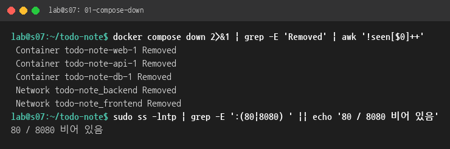
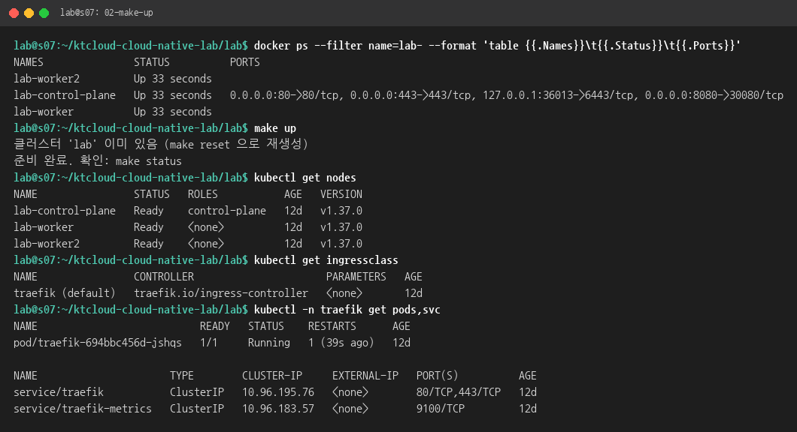
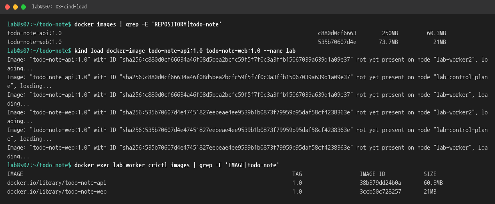
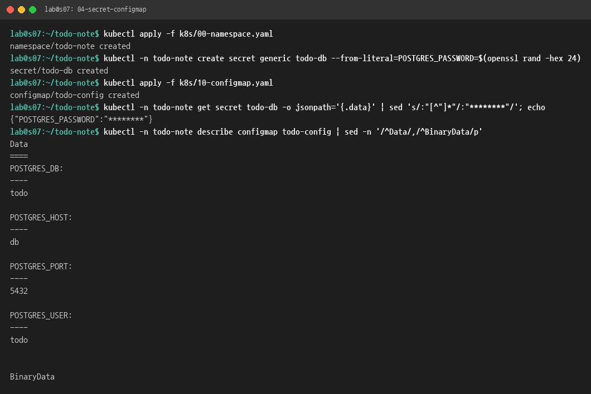
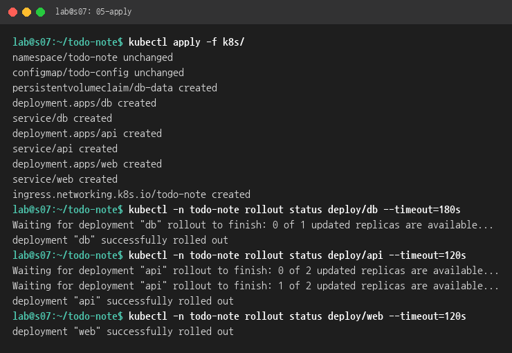
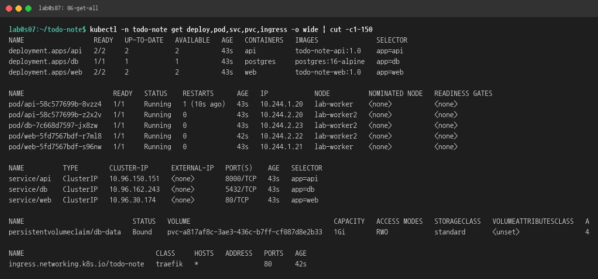
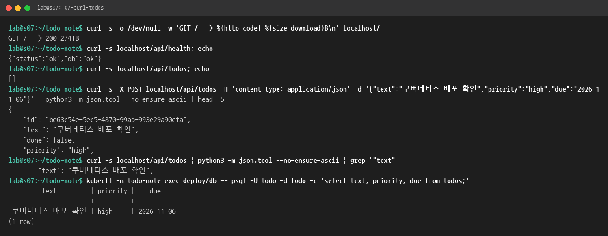
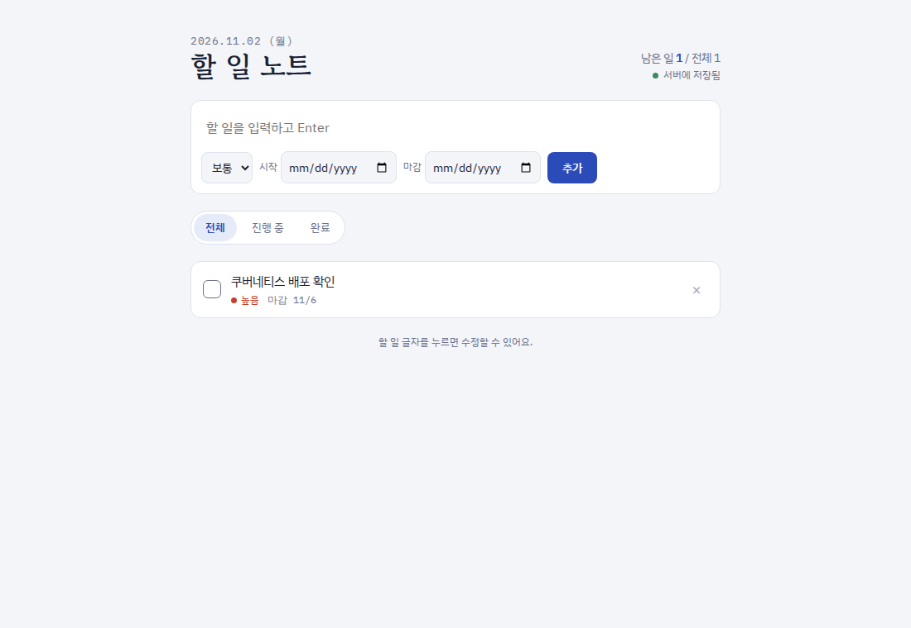
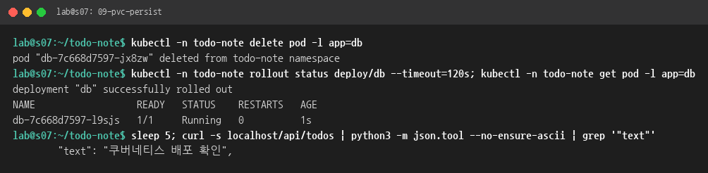

# 4단계 보고서: Kubernetes에 배포하기

- 대상 VM: `ktc-s07`, kind 클러스터 `lab` (노드 3개, Kubernetes v1.37.0, Ingress: Traefik)
- 작업일: 2026-11-02
- 앞 단계: [3단계 Docker Compose](../step3-compose/REPORT.md)

## 1. 결과 요약

| 확인 항목 | 결과 | 캡처 |
|---|---|---|
| 3단계 이미지를 `kind load`로 클러스터에 넣기 | ✅ 노드 3개에 `todo-note-api:1.0`, `todo-note-web:1.0` 적재 | [03](img/03-kind-load.png) |
| web·api: Deployment + Service | ✅ 각 2개 파드 Running | [06](img/06-get-all.png) |
| db: Deployment + Service + PVC | ✅ PVC `db-data` Bound(1Gi) | [06](img/06-get-all.png) |
| 비밀번호는 Secret, 그 밖의 설정은 ConfigMap | ✅ `todo-db`(Secret), `todo-config`(ConfigMap) | [04](img/04-secret-configmap.png) |
| Ingress: `/`는 web, `/api`는 api | ✅ `localhost/` 200, `localhost/api/health` ok | [07](img/07-curl-todos.png) |
| **`curl localhost/api/todos`와 브라우저** | ✅ 추가·조회 동작, 화면 표시 | [07](img/07-curl-todos.png), [08](img/08-browser.png) |
| (추가) DB 파드를 지워도 데이터 유지 | ✅ 새 파드가 같은 PVC를 붙여 데이터 그대로 | [09](img/09-pvc-persist.png) |

## 2. 구성 한눈에 보기

```
브라우저 ──▶ localhost:80 ──▶ Traefik (Ingress 컨트롤러)
                                 │  Ingress todo-note
                                 ├── /api ──▶ Service api:8000 ──▶ Pod api ×2 ─┐
                                 └── /    ──▶ Service web:80   ──▶ Pod web ×2  │
                                                                                ▼
                                            Service db:5432 ──▶ Pod db ×1 ──▶ PVC db-data (1Gi)
           ConfigMap todo-config (DB 이름·사용자·호스트) / Secret todo-db (비밀번호) ──▶ api·db 파드의 환경변수
```

> **용어**
> - **Pod(파드)**: 컨테이너를 실행하는 가장 작은 단위입니다.
> - **Deployment**: 파드를 몇 개 유지할지 정합니다. 파드가 죽으면 새로 만들어 줍니다.
> - **Service**: 파드 여러 개 앞에 붙는 고정 주소(이름)입니다. 예: `db:5432`.
> - **PVC**: 파드가 바뀌어도 남는 디스크를 요청하는 것입니다(Compose의 볼륨과 같은 역할).
> - **ConfigMap / Secret**: 설정값과 비밀값을 파드에 환경변수로 넣어 줍니다.
> - **Ingress**: 밖에서 들어온 요청을 경로에 따라 Service로 나눠 보내는 규칙입니다.

## 3. 매니페스트 파일

저장소의 [k8s/](../../k8s/) 폴더에 있습니다. 번호 순서대로 읽으면 됩니다.

| 파일 | 만드는 것 | 핵심 |
|---|---|---|
| [00-namespace.yaml](../../k8s/00-namespace.yaml) | Namespace `todo-note` | 다른 실습과 섞이지 않게 분리 |
| [10-configmap.yaml](../../k8s/10-configmap.yaml) | ConfigMap `todo-config` | `POSTGRES_USER/DB/HOST/PORT` |
| [20-db.yaml](../../k8s/20-db.yaml) | PVC `db-data`, Deployment `db`, Service `db` | `postgres:16-alpine`, `strategy: Recreate`, `PGDATA` 하위 폴더 |
| [30-api.yaml](../../k8s/30-api.yaml) | Deployment `api`(2개), Service `api` | `imagePullPolicy: IfNotPresent`, readiness `/health` |
| [40-web.yaml](../../k8s/40-web.yaml) | Deployment `web`(2개), Service `web` | 3단계 web 이미지 그대로 |
| [50-ingress.yaml](../../k8s/50-ingress.yaml) | Ingress `todo-note` | `/api` → api:8000, `/` → web:80 |

Secret은 **파일로 만들지 않았습니다.** 비밀번호가 Git에 올라가지 않게 하려고 명령으로 만듭니다(3.3).

## 4. 따라 하기

### 4.1 3단계 컨테이너 내리기 → 클러스터 켜기
kind 클러스터는 VM의 **80과 8080**을 씁니다. 3단계의 web 컨테이너도 8080을 쓰므로 먼저 내립니다. 볼륨은 남으니 3단계 데이터는 안전합니다.
```bash
cd ~/todo-note && docker compose down
```



이 VM에는 이미 `lab` 클러스터가 있었습니다. 2단계에서 80번 포트를 쓰려고 멈춰 두었기 때문에, 컨테이너를 다시 켜고 `make up`을 실행했습니다.
```bash
cd ~/ktcloud-cloud-native-lab/lab
docker start lab-control-plane lab-worker lab-worker2   # (멈춰 둔 경우에만)
make up                                                 # 클러스터가 없으면 새로 만들어 줌
kubectl get nodes                                       # 3개 모두 Ready
kubectl get ingressclass                                # traefik (default)
```
- `make up`은 클러스터가 이미 있으면 "이미 있음"이라고 알려 주고, metrics-server만 다시 적용합니다.
- 처음 만드는 클러스터라면 Ingress 컨트롤러도 필요합니다. 이때는 `make ingress`를 한 번 실행하세요.



### 4.2 3단계 이미지를 클러스터에 넣기
kind 노드는 VM의 Docker 이미지를 바로 보지 못합니다. 그래서 `kind load`로 노드마다 복사해 넣습니다.
```bash
kind load docker-image todo-note-api:1.0 todo-note-web:1.0 --name lab
docker exec lab-worker crictl images | grep todo-note    # 노드 안에서 확인
```



> 매니페스트에 `imagePullPolicy: IfNotPresent`를 꼭 넣으세요. 태그가 `latest`가 아니면 기본값이 IfNotPresent이긴 하지만, 명시해 두면 "인터넷에서 받으려다 `ErrImagePull`" 실수를 막을 수 있습니다.

### 4.3 Namespace, Secret, ConfigMap
```bash
cd ~/todo-note
kubectl apply -f k8s/00-namespace.yaml
kubectl -n todo-note create secret generic todo-db \
  --from-literal=POSTGRES_PASSWORD=$(openssl rand -hex 24)
kubectl apply -f k8s/10-configmap.yaml
```
- Secret은 db와 api 파드에 같은 값으로 들어가기 때문에, 비밀번호를 사람이 몰라도 됩니다.
- 확인 화면에서는 비밀번호를 `********`로 가렸습니다. 실제 값은 base64로만 인코딩되어 있을 뿐 암호화된 것이 아니니, 함부로 출력하지 마세요.



### 4.4 나머지 전부 적용
```bash
kubectl apply -f k8s/                       # 폴더째 적용 (이미 있는 것은 unchanged)
kubectl -n todo-note rollout status deploy/db
kubectl -n todo-note rollout status deploy/api
kubectl -n todo-note rollout status deploy/web
```



```bash
kubectl -n todo-note get deploy,pod,svc,pvc,ingress -o wide
```
확인할 점은 다음과 같습니다.
- Deployment가 모두 `READY 2/2`(db는 `1/1`)입니다.
- 파드가 `lab-worker`와 `lab-worker2`에 나뉘어 떠 있습니다.
- PVC가 `Bound`입니다.
- Ingress의 `HOSTS`가 `*`이라서 `localhost`로 접속할 수 있습니다.



> 캡처에서 api 파드 하나의 `RESTARTS`가 1입니다. 아래 "문제와 해결"을 보세요.

### 4.5 과제 확인: curl과 브라우저
```bash
curl localhost/                 # 200 (web의 index.html)
curl localhost/api/health       # {"status":"ok","db":"ok"}
curl localhost/api/todos        # [] → 할 일 추가 → 다시 조회
kubectl -n todo-note exec deploy/db -- psql -U todo -d todo -c 'select text, priority, due from todos;'
```



브라우저: VS Code **PORTS** 탭에서 `80`을 추가하고 `http://localhost`를 엽니다.



### 4.6 (추가 확인) DB 파드를 지워도 데이터가 남는지
```bash
kubectl -n todo-note delete pod -l app=db       # Deployment가 새 파드를 바로 만듦
kubectl -n todo-note get pod -l app=db          # 이름이 바뀐 새 파드
curl localhost/api/todos                        # 데이터 그대로
```



## 5. 문제와 해결

| 문제 | 원인 | 해결 |
|---|---|---|
| `make up`이 `failed to download openapi`로 실패 | 멈췄던 클러스터를 막 켠 직후라 API 서버가 아직 준비되지 않음 | 노드가 Ready가 된 뒤 `make up` 재실행 → 성공 |
| api 파드 하나가 처음에 1번 재시작 | DB 파드가 이미지를 받고 초기화하는 동안 API가 30초 동안 DB에 연결하지 못하고 종료(`PoolTimeout`). Kubernetes에는 Compose의 `depends_on: service_healthy` 같은 시작 순서 보장이 없음 | 조치 없음. Kubernetes가 자동으로 다시 띄웠고, 그 뒤로는 정상(readinessProbe 덕분에 준비 전에는 트래픽을 받지 않음) |
| (예방) web 파드가 `host not found in upstream "api"`로 죽을 수 있음 | web 이미지의 nginx.conf가 `http://api:8000`을 찾음 | api의 Service 이름을 반드시 **`api`**로 지음 |
| (예방) Ingress에서 `/api` 앞부분을 떼야 하나? | API가 `root_path="/api"`라서 `/api/todos`를 그대로 받아도 `/todos`로 처리함 | 경로를 떼는 미들웨어 없이 Ingress만으로 동작 |

## 6. 3단계와 비교

| | Docker Compose | Kubernetes |
|---|---|---|
| 설계도 | `compose.yaml` 1개 | `k8s/*.yaml` 6개 |
| 실행 | `docker compose up -d` | `kubectl apply -f k8s/` |
| 비밀번호 | `.env` | Secret `todo-db` |
| 설정 | compose 안의 `environment` | ConfigMap `todo-config` |
| 데이터 | 볼륨 | PVC (local-path 프로비저너) |
| 입구 | web 컨테이너 포트 8080 | Ingress(Traefik) 80, `/api`는 web을 거치지 않고 api로 바로 |
| 개수 | 서비스마다 1개 | web·api 2개씩, 죽으면 자동 복구 |
| 시작 순서 | `depends_on`으로 보장 | 보장 없음 → 재시작과 readinessProbe로 해결 |

## 7. 정리(지우기)
```bash
kubectl delete namespace todo-note     # 이 단계에서 만든 것 전부 (PVC 데이터 포함)
```
